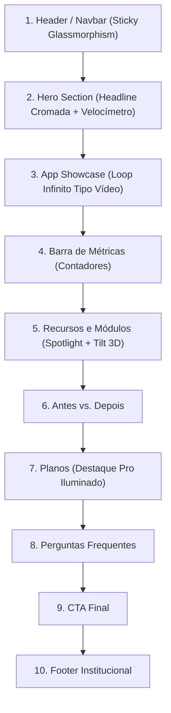

# 🏎️ Plano Diretor de Redesign e Animações — Landing Page AutoCore

> **Projeto:** `landingpage-autocore`  
> **Documento:** `docs/plano_redesign_landing_autocore.md`  
> **Objetivo:** Elevar a estética visual, aplicar a paleta de cores do logo oficial e incorporar micro-interações e animações contínuas sem fugir do layout atual, para apresentar o progresso ao cliente e acelerar o lançamento comercial.

---

## 0. Status de Execução

| Fase | Escopo | Status |
|:--:|:---|:--:|
| **1** | Design Tokens (`index.css` + `tailwind.config.ts`) | ✅ Concluída (aguardando build de validação) |
| **2** | Componentes de animação reutilizáveis (`InfiniteShowcaseReel`, `SpotlightCard`) | ⏳ Pendente |
| **3** | Refatoração das seções (`LandingNav`, `AppPreview`, `PlansSection`, `Index.tsx`) | ⏳ Pendente |
| **4** | Validação final e build (`npm --prefix landingpage-autocore run build`) | ⏳ Pendente |

---

## 1. Identidade Visual Baseada no Logo Oficial

> O logo oficial apresenta: emblema **"A"** em prata cromado com ponteiro de velocímetro vermelho, palavra **"Auto"** em prata/branco, **"Core"** em azul elétrico, sobre fundo azul profundo com uma linha de luz horizontal (horizonte).

### 🎨 Paleta Cromática Extraída do Logo

| Token CSS | HSL | Inspiração no Logo | Aplicação na Landing Page |
|:---|:---|:---|:---|
| `--brand-navy` / `--background` | `226 60% 5%` | Fundo escuro com brilho sutil | Fundo da página, surfaces (`--surface-0..3`) |
| `--brand-blue` / `--primary` | `211 100% 50%` | Palavra **"Core"** | Cor primária, destaques, links, ring de foco |
| `--brand-cyan` | `199 100% 55%` | Brilho da palavra "Core" e linha do horizonte | Gradientes de texto, neon, scanline |
| `--brand-red` / `--racing` | `357 100% 56%` | Ponteiro e velocímetro do **"A"** | CTAs de conversão (`.btn-racing`), badges de urgência |
| `--brand-chrome` / `--chrome` | `215 20% 75%` | Aro metálico e palavra **"Auto"** | Tipografia de manchete (`.text-chrome`), bordas polidas |

### Utilitários criados na Fase 1

| Classe | Uso |
|:---|:---|
| `.text-chrome` / `.text-gradient-hero` | Texto prata cromado (estilo "Auto") |
| `.text-gradient` | Texto azul elétrico → ciano (estilo "Core") |
| `.text-racing` | Texto em gradiente vermelho racing |
| `.btn-racing` | Botão CTA vermelho com glow e hover elevado |
| `.glow-blue` / `.glow-racing` | Brilho de marca (`.glow-orange` mantido como alias legado → azul) |
| `.lp-aurora` | Fundo atmosférico com glow azul (e toque vermelho) |
| `.lp-horizon` | Linha de luz horizontal inspirada no logo |
| `.mask-fade-x` | Fade lateral para o carrossel infinito |

### Animações registradas no Tailwind (Fase 1)

| Classe | Keyframe | Duração / Easing | Uso previsto |
|:---|:---|:---|:---|
| `animate-marquee` / `animate-marquee-slow` | `marquee` | 40s / 70s `linear infinite` | Carrossel "vídeo passando" |
| `animate-scanline` | `scanline` | 6s `ease-in-out infinite` | Linha de luz no mockup do app |
| `animate-needle-idle` | `needle-idle` | 3s `ease-in-out infinite` | Ponteiro do velocímetro |
| `animate-glow-pulse` | `glow-pulse` | 2.8s `ease-in-out infinite` | Pulso luminoso em CTA/badges |
| `animate-shimmer` | `shimmer` | 6s `linear infinite` | Reflexo metálico no texto cromado |
| `animate-float` | `float` | 6s `ease-in-out infinite` | Flutuação suave de elementos decorativos |

> [!NOTE]
> Acessibilidade: `@media (prefers-reduced-motion: reduce)` neutraliza animações e transições para usuários que preferem menos movimento.

---

## 2. Mapa das Seções da Landing Page

---

## 3. Especificação por Seção

### 📍 Seção 1: Header / Navbar
- Fundo translúcido com `backdrop-blur-xl` e borda inferior em gradiente azul profundo → ciano (`.lp-horizon`).
- Links com pill deslizante (`framer-motion` `layoutId`).
- *"Testar Grátis"* com `.btn-brand` (gradiente Azul Elétrico → Ciano, preservando a psicologia de decisão/confiança, sem usar vermelho em botões).

### 📍 Seção 2: Hero Section
- Headline com *"Auto"* em `.text-chrome` e *"Core"* em `.text-gradient`.
- Badge de velocímetro com ponteiro vermelho que oscila (`animate-needle-idle`).
- Fundo `.lp-aurora` + `.lp-grid-lines` + `.lp-horizon`.
- Botão principal com `.btn-brand` (Azul Elétrico → Ciano).

### 📍 Seção 3: App Showcase ("Vídeo Passando")
- Carrossel horizontal infinito de telas/cards do ERP (`InfiniteShowcaseReel.tsx`), com rolagem contínua em `60fps` (`useAnimationFrame`) e `.mask-fade-x`.
- **Hover:** desaceleração suave (`mouseEnter` → `hoverSpeed`, `mouseLeave` → `speed`) para leitura confortável.
- **Scanline:** linha de luz ciano percorrendo o mockup periodicamente (`Scanline.tsx`).

### 📍 Seção 4: Recursos e Módulos
- **Spotlight Mouse Follow:** luz radial azul segue o cursor (`onMouseMove` com coordenadas relativas ao card).
- **Tilt 3D suave:** inclinação de 2–4° conforme a posição do mouse; reset suave no `mouseleave`.
- Borda ativa com filete em gradiente Vermelho Racing ↔ Azul Elétrico no hover/foco.
- **Tour Automático nas Tabs:** alternância automática entre as telas do ERP (pausável no hover/clique).

### 📍 Seção 5: Planos e Preços
- Card "Pro" com aura azul constante (`.glow-blue`), tag *"Recomendado"* em Azul Elétrico e CTA com `.btn-brand`.
- Toggle mensal/anual com transição elástica (`layoutId`) e animação de troca nos preços (`AnimatePresence`).

---

## 4. Matriz de Animações e Níveis de Interação

| Nível | Tecnologia | Gatilho | Comportamento |
|:---|:---|:---|:---|
| **Fade-in / Stagger Reveal** | `framer-motion` (`whileInView`) | Scroll | `opacity 0 → 1` + `translateY 20px → 0`, stagger de 0.1s entre filhos |
| **Fade-out** | `framer-motion` (`AnimatePresence`) | Troca de abas/telas | Saída suave com opacidade e leve deslocamento |
| **Mousein / Mouseout** | CSS transitions + `framer-motion` | Hover | Scale 1.02, borda iluminada em ciano, sombra amplificada |
| **Loop infinito (efeito vídeo)** | `useAnimationFrame` + CSS keyframes | Automático | Rolagem contínua `linear infinite` com fade lateral; desacelera no hover |
| **Ponteiro esportivo / reflexo** | CSS keyframes | Automático | `needle-idle`, `shimmer`, `glow-pulse`, `scanline` |

---

## 5. Roteiro de Execução

1. **Fase 1 — Design Tokens:** ✅ `index.css` e `tailwind.config.ts` atualizados com a paleta oficial, utilitários de marca (`.btn-brand` em Azul Elétrico para CTAs e `--racing` restrito a alertas e detalhes do velocímetro) e keyframes.
2. **Fase 2 — Componentes reutilizáveis:** ✅ Concluído
   - `src/components/landing/motion/InfiniteShowcaseReel.tsx`
   - `src/components/landing/motion/SpotlightCard.tsx`
   - `src/components/landing/motion/Reveal.tsx`
   - `src/components/landing/motion/Scanline.tsx`
3. **Fase 3 — Refatoração das seções:** ✅ Concluído (`LandingNav`, `AppPreview`, `PlansSection`, `LandingFooter`, `Index.tsx`).
4. **Fase 4 — Validação:** ✅ Concluído (`npm --prefix landingpage-autocore run build` executado com 0 erros em 8.34s).

